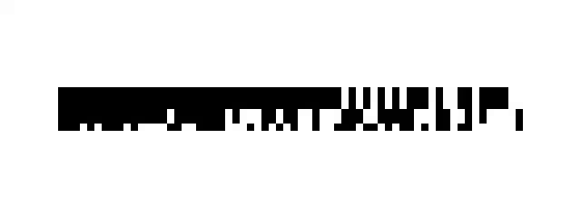

latency-clock
=============

Measure the latency of a video-output/video-capture combination.

`server` generates a video, drawing timestamps onto the video itself as 64-bit
nanoseconds binary in 8x8px black and white boxes.  It is intended to be run on
a Raspberry Pi, but should work anywhere.

There are six timestamps recorded.  The relevant one is the sixth.  This is the
time the frame will be displayed as 64-bit nanoseconds since the unix epoch
(realtime).

The output looks like:

`server` draws the time at which GStreamer hands the frame to the display, but
the frame isn't scanned out until the next vsync after that.  GStreamer's
frame clock and the display's pixel clock aren't locked together, so this
wait drifts slowly between 0 and 1 frame and then wraps, and shows up as a
sawtooth in the measured latency.

`dispmanx-server` is a second implementation for the Raspberry Pi's legacy
(non-KMS) display stack that avoids this.  It renders in step with the
display: it gets a callback on every vsync, fits a line through the callback
times to predict future vsyncs, and draws each frame with the predicted time
of the vsync at which it will be shown.  It logs any frame that misses its
vsync to stdout ("late frame render_realtime ..."), so those can be
excluded, and prints statistics to stderr every 10 seconds.  The time it
draws is the time of the vsync callback, which isn't necessarily the time
of the first active line; use `--offset-us` to correct for that if you know
it.  Build it with `make dispmanx-server` (it needs `/opt/vc` from
libraspberrypi-dev).

`client` reads the timestamps back from the video and logs the latency to stderr
when run with `GST_DEBUG=timeoverlayparse:4`.  It is intended to be run on a
system that is capturing the video generated by the Raspberry Pi.

`client.py` is a separate implementation of the client in Python, using
[stb-tester](https://stb-tester.com).

Clock synchronisation
---------------------

The latency is the difference between two clocks: the client's (when the frame
was received) and the server's (when it was displayed).  NTP over the internet
typically leaves these several milliseconds apart, and the offset wanders.  To
measure it, the servers answer time requests on UDP port 10123.
`timeclient.py HOST` (or `timeclient.OffsetTracker` from Python) does an
NTP-style exchange and reports the offset between the clocks, accurate to half
of the network round-trip time (typically well under 0.1ms on a LAN):

    latency = receive_time - render_realtime + offset

For an example use-case see
<https://stb-tester.com/blog/2016/07/05/latency-measurements>.

LICENCE
-------

LGPLv2.1, the same as GStreamer that this is based on.
